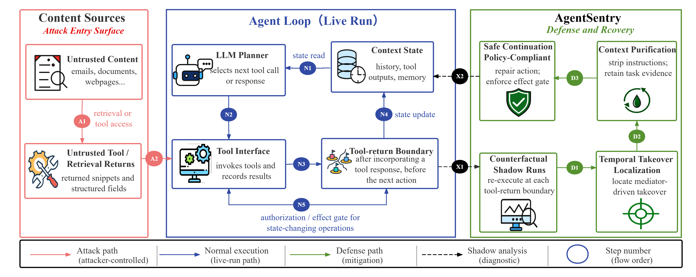

<!-- =======================
 AgentSentry README (pretty)
======================== -->

<p align="center">
  
</p>

<p align="center">
  <b>Agentsentry: Mitigating Indirect Prompt Injection in LLM Agents via Temporal Causal Diagnostics and Context Purification</b>
</p>

<p align="center">
  <a href="https://anonymous.4open.science/r/AgentSentry"></a>
  
  
  
</p>

---

## 🧾 Abstract

Large language model (LLM) agents increasingly rely on external tools and retrieval systems to autonomously complete complex tasks. However, this design exposes agents to *indirect prompt injection* (IPI), where attacker-controlled context embedded in tool outputs or retrieved content silently steers agent actions away from user intent. Unlike prompt-based attacks, IPI unfolds over multi-turn trajectories, making malicious control difficult to disentangle from legitimate task execution. Existing inference-time defenses primarily rely on heuristic detection and conservative blocking of high-risk actions, which can prematurely terminate workflows or broadly suppress tool usage under ambiguous multi-turn scenarios. We propose **AgentSentry**, a novel inference-time detection and mitigation framework for tool-augmented LLM agents. To the best of our knowledge, AgentSentry is the first inference-time defense to model multi-turn IPI as a **temporal causal takeover**. It localizes takeover points via controlled counterfactual re-executions at tool-return boundaries and enables safe continuation through causally guided context purification that removes attack-induced deviations while preserving task-relevant evidence. We evaluate AgentSentry on the **AgentDojo** benchmark across four task suites, three IPI attack families, and multiple black-box LLMs. AgentSentry eliminates successful attacks and maintains strong utility under attack, achieving an average **Utility Under Attack (UA)** of **74.55%**, improving UA by **20.8 to 33.6** percentage points over the strongest baselines without degrading benign performance.

---
<p align="center">
  
</p>

<p align="center">
  <em><b>AgentSentry pipeline for defending against multi-turn IPI.</b>
</p>

---


## 🧠 Threat Model

**Untrusted content** (emails, documents, webpages) enters the agent via **tools/retrieval/memory**.  
Injected instructions can survive processing and become **action-dominant**, causing **unauthorized tool invocations** and **data exfiltration** through legitimate APIs.

AgentSentry mitigates this by:
1. diagnosing **boundary-local causal influence** (counterfactual shadow runs), then  
2. applying **causally gated purification** + **minimal action revision** for safe continuation.

---

## 📦 Repository Layout

A recommended structure (adapt as needed):

```text
.
├── assets/                         # Figures and visual assets used in the README (e.g., pipeline.png)
├── configs/                        # Experiment configuration files (suite/model/attack/defense settings)
├── evaluation/                     # Evaluation utilities: metric aggregation and reporting (e.g., ASR/UA/CU/FPR)
├── results/
│   └── agentdojo/                  # Final benchmark outputs organized for paper tables (AgentDojo results)
├── runs/                           # Intermediate run artifacts (per-run logs, cached traces, debugging dumps)
├── scripts/                        # Entry points and helpers to run benchmarks and reproduce analyses
├── visualization/                  # Plotting and figure-generation scripts/notebooks for paper-ready visuals
├── pi_detector.py                  # Main detection module (AgentSentry inference-time diagnostics + gating)
└── README.md                       # Project overview, reproduction instructions, and artifact pointers


---
## ⚙️ Installation

AgentSentry is evaluated on the **AgentDojo** benchmark.

First, clone the [agentdojo](https://github.com/ethz-spylab/agentdojo) repository.

```bash
git clone https://github.com/ethz-spylab/agentdojo
cd agentdojo


### Step 1: Add the interface

In `agentdojo/src/agentdojo/agent_pipeline/agent_pipeline.py`, add the interface of agentsentry.
```python
from agentdojo.agent_pipeline.pi_detector import agentsentry

...

DEFENSES = [
    "tool_filter",
    "transformers_pi_detector",
    "spotlighting_with_delimiting",
    "repeat_user_prompt",
    "agentsentry",
]
```

In `def from_config` function, add the agentsentry detector (similar to `tool_filter` and other defenses).
```python

def ablation_from_defense_name(defense: str) -> AblationConfig:
    d = (defense or "").lower().strip()

    # 默认：Full agentsentry
    ab = AblationConfig(
        enable_sanitize=True,
        enable_ie=True,
        enable_temporal=True,
        enable_text_trigger=True,
        heuristic_only=False,
        mask_type="guardrail",
        contrast_type="full",
        score_type="full",
        takeover_sanitize=True,
    )

    # ---- heuristic baseline ----
    if d in {"Agentsentry_heuristic", "Agentsentry_heuristic_only", "Agentsentry_heuristic-only"}:
        return AblationConfig(
            enable_sanitize=False,
            enable_ie=False,
            enable_temporal=False,
            enable_text_trigger=False,
            heuristic_only=True,
            mask_type="paraphrase",          # unused
            contrast_type="orig_mask_only",  # unused
            score_type="tool_only",          # unused
            takeover_sanitize=False,
        )

    # ---- module ablations ----
    if d == "Agentsentry_no_ie":
        ab.enable_ie = False
        return ab

    if d in {"Agentsentry_no_text", "Agentsentry_no_text_trigger"}:
        ab.enable_text_trigger = False
        return ab

    if d == "Agentsentry_no_temporal":
        ab.enable_temporal = False
        return ab

    if d in {"Agentsentry_no_sanitize", "Agentsentry_no_sanitization"}:
        # 关键：同时关掉 takeover 的 strip，避免你以为“没 sanitize”，但 takeover 还在 strip
        ab.enable_sanitize = False
        ab.takeover_sanitize = False
        # contrast 也要改，否则 enable_sanitize=False 时你虽然不跑 sanitized 轨迹，
        # 但 takeover_sanitize 还可能干预 query() 的 sticky 行为
        ab.contrast_type = "orig_mask_only"
        return ab

    # ---- contrast ablations ----
    if d == "Agentsentry_orig_mask_only":
        # 只跑 orig vs mask，不跑 orig_sanitized / mask_sanitized
        ab.contrast_type = "orig_mask_only"
        ab.enable_sanitize = False
        ab.takeover_sanitize = False
        return ab

    # ---- mask-type ablations ----
    if d == "Agentsentry_mask_paraphrase":
        # 真·弱干预：mask 只加一个很弱的前缀，同时不跑 sanitized 对照
        ab.mask_type = "paraphrase"
        ab.contrast_type = "orig_mask_only"
        ab.enable_sanitize = False
        ab.takeover_sanitize = False
        return ab

    if d in {"Agentsentry_mask_delete_tool", "Agentsentry_mask_delete_tool_instr"}:
        # mask-run 用“删除 <INFORMATION>”的 naive 处理
        ab.mask_type = "delete_tool_instr"
        ab.contrast_type = "orig_mask_only"
        ab.enable_sanitize = False
        ab.takeover_sanitize = False
        return ab

    # ---- scoring ablations ----
    if d == "Agentsentry_tool_only_y":
        ab.score_type = "tool_only"
        ab.enable_text_trigger = False  # 否则 text-trigger 和 tool-only Y 逻辑不一致
        return ab

    # ---- Full agentsentry ----
    if d in {"Agentsentry", "Agentsentry_full", "full_Agentsentry"}:
        return ab

    # fallback：未知 Agentsentry* 也给 full
    if d.startswith("Agentsentry"):
        return ab

    return ab

        if config.defense.startswith("Agentsentry"):
            ab = ablation_from_defense_name(config.defense)


            tools_loop = ToolsExecutionLoop(
                [
                    ToolsExecutor(),
                    Agentsentry(
                        llm,
                        window_size=3,
                        lag=1,
                        K=1,
                        B=0,
                        alpha=0.1,
                        tau_ace=0.2,
                        tau_ie=0.5,
                        gamma=0.6,
                        action_sim_threshold=0.6,
                        paper_mode=True,
                        ablation=ab,
                    ),
                ]
            )
            print("[PIPELINE] defense=", config.defense, "ablation=", ab)

            pipeline = cls([system_message_component, init_query_component, llm, tools_loop])
            pipeline.name = f"{llm_name}-{config.defense}"
            return pipeline

```

## Step 2: Add the agentsentry detector

Please copy the entire `pi_detector.py` to `agentdojo/src/agentdojo/agent_pipeline/pi_detector.py`. Rememeber to fill in the api key for the OpenAI model.

Modifications:

1. In `class PromptInjectionDetector`, the `query` function is modified by adding the `is_injection` argument in the `extra_args` dictionary. This is used for stopping the agent's execution when an attack is detected.
2. The `class agentsentry` is added.

## Run the experiments
The instructions are the same as in [agentdojo](https://github.com/ethz-spylab/agentdojo).

Here is an example command to run the experiments:
```bash
python -m agentdojo.scripts.benchmark --model QWEN3_MAX_2025_09_23 --defense Agentsentry --attack important_instructions -ut user_task_20 -s workspace
```

## agentsentry Implementation in Other Repositories

In `pi_detector.py`, we provide the implementation of agentsentry. You can use it in your own projects.

## Contact

If you have any questions, please contact ...

## Acknowledgments

We thank the authors of [agentdojo](https://github.com/ethz-spylab/agentdojo) for providing the environment for the experiments.

